  

building [vinskal](https://vinskal.com), a job search platform that finds the roles, tailors each application, and applies once you've signed off. i work on the discovery pipeline behind 500k+ live postings and the browser agent that does the applying.

before this: pinterest's first-party agentic harness for autonomous vulnerability discovery and validation, and the personalization layer behind multilingual music recommendations for amazon music and alexa.

statistics + cs @ uiuc in the background, with a [paper at sigcse ts 2026](https://dl.acm.org/doi/10.1145/3770761.3777297). when i'm not building, i'm probably [producing music](https://www.youtube.com/watch?v=_RL_57Qamyo). i also write sometimes: [rohan-is.me](https://www.rohan-is.me).

<!-- last-listened:start -->
last listened to: [worldwide](https://www.last.fm/music/OsamaSon/_/worldwide) by osamason
<!-- last-listened:end -->

<samp>
  <a href="https://www.rohan-is.me">personal website</a> ·
  <a href="https://vinskal.com">vinskal</a> ·
  <a href="https://www.rohan-is.me/ROHAN_KUMAR.pdf">resume</a> ·
  <a href="https://linkedin.com/in/rohankumarrr313">linkedin</a> ·
  <a href="https://x.com/rohankumarrr313">x</a> ·
  <a href="mailto:rohankumarrr313@gmail.com">email</a>
</samp>
